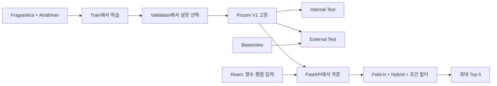

[https://scent-match-team12.vercel.app](https://scent-match-team12.vercel.app)

# SCENT MATCH

### Personalized Perfume Recommendation System · Team 12

사용자가 알고 있는 향수와 0–10점 평점을 입력하면 취향에 맞는 향수를 최대 5개 추천하는 머신러닝 프로젝트입니다. 향수의 노트·어코드를 이용한 콘텐츠 기반 필터링과 사용자 평점 기반 행렬 분해를 결합하고, 사용자가 선택한 향 조건으로 결과를 제한합니다.

## 프로젝트 목표

온라인에서는 직접 향을 맡기 어렵고, 많은 향수 중에서 개인 취향에 맞는 제품을 비교하기 어렵습니다. SCENT MATCH는 이미 경험한 향수에 대한 평가를 이용해 새로운 향수를 탐색하도록 돕습니다.

## 주요 기능

- 향수 이름·브랜드·노트 검색과 평점 입력
- 콘텐츠 점수 25%와 MF 점수 75%를 결합한 Hybrid 추천
- 신규 사용자의 평점으로 사용자 벡터를 계산하는 Ridge fold-in
- 향 조건에 따른 필터링과 입력 향수 제외
- 최대 Top 5, 입력 향수와 겹치는 노트, Match score 표시

Match score는 `1 + 9 × Hybrid score`로 표시한 순위 점수이며, 사용자가 줄 평점이나 선호 확률을 의미하지 않습니다.

## 데이터

| 데이터 | 용도 | 규모 |
|---|---|---:|
| Fragrantica | 노트·어코드 콘텐츠 특징 | 24,063개 향수 |
| Atrafshan | 사용자 향기 평점, 모델 개발 | 0점 제외·매칭 후 3,323개 평점 |
| Basenotes | 고정 모델의 외부 사용자 평가 | 원본 리뷰 6,288개 |
| Parfumo | 향수 메타데이터 보조 교차 확인 | 59,325행 |

최종 Train은 330명·538개 향수·1,805개 평점입니다. 최소 평점 조건들을 같은 후보에서 비교하기 위해 공통 후보 479개를 사용했습니다. Atrafshan의 0점 의미는 확정하지 않았으며, 0점 제외는 분석 가정으로 채택하고 포함 결과도 민감도 분석으로 확인했습니다.

원본 데이터와 개인별 평점은 저장소에서 제외합니다. 데이터 출처와 범위는 [데이터 안내](data/README.md)와 [참고자료](REFERENCES.md)를 확인하세요. 공개된 코드와 원본 데이터·파생 자산의 이용 조건은 별개입니다.

## 추천 방법과 구조

1. Train의 노트·어코드로 TF-IDF 특징을 만들고, 평점으로 가중한 사용자 콘텐츠 프로필과 후보 간 코사인 유사도를 구합니다.
2. MF는 관측 평점의 오차와 L2 정규화 항을 SGD로 최소화합니다.
3. `Hybrid = 0.25 × Content + 0.75 × MF`로 결합합니다.
4. 신규 사용자는 고정된 향수 요인으로 Ridge fold-in을 수행합니다.
5. 선택한 향 조건을 적용하고 이미 입력한 향수를 제외해 최대 5개를 반환합니다.



상세 수식과 구현 설명은 [METHODS_EXPLAINED.md](METHODS_EXPLAINED.md)에 있습니다.

## 평가 결과

주 지표는 NDCG@10입니다. 설정과 최종 Hybrid는 Validation으로 선택하고, 이후 모델을 동결해 Test를 평가했습니다.

| 모델 | Validation | Internal Test | External Test |
|---|---:|---:|---:|
| Popularity | 0.032790 | 0.030404 | 0.023583 |
| Content-based | 0.028903 | 0.019920 | 0.003364 |
| MF | 0.023056 | **0.041180** | **0.050456** |
| Hybrid | **0.043185** | 0.038533 | 0.026365 |

Validation 적격 사용자 168명 중 긍정 정답이 있는 137명, Internal 168명 중 136명, External 35명 중 26명으로 정확도를 평균했습니다. Hybrid는 Validation에서 선택한 최종 모델이며, 두 Test의 관측 NDCG 최고 모델은 MF입니다. Test 결과를 보고 모델을 다시 선택하지 않았습니다.

평가 범위는 기존 카탈로그에 매칭되는 상품과 제한된 사용자 집단입니다. 실제 사용자 만족도나 통계적 우월성을 입증한 결과로 해석하지 않습니다.

## 추가 실험

발표에서는 Bias-aware MF, BPR Hybrid, PNContent Hybrid, 유사도 재정렬, Structured Hybrid를 비교했습니다. 이들은 별도의 개발 CV에서 NDCG@5로 평가했으므로 위의 최종 NDCG@10과 직접 비교하지 않습니다.

유사도 재정렬의 개발 개선은 과거 평가 이력이 있는 Reserved 집단의 재검증에서 재현되지 않았습니다. Structured Hybrid의 개발 개선도 새로운 독립 사용자 데이터로 검증되지 않아 최종 서비스에는 적용하지 않았습니다. kNN과 Parfumo는 최종 모델 동결 후 별도로 확인한 보조 실험입니다.

## 코드 구성

| 경로 | 내용 |
|---|---|
| `src/perfume/` | 데이터 처리, Content·MF·Hybrid, 평가와 fold-in |
| `configs/` | 개발·모델 선택 설정 |
| `scripts/` | 전처리·학습·동결·평가 실행 도구 |
| `web/frontend/` | React·TypeScript·Vite 화면 |
| `web/backend/` | FastAPI, 검색과 추천 API |
| `deployment/final_v1/` | 설치·실행 진입점 |
| `deployment/standalone_v1/` | 저장된 모델 자산을 읽는 로더 |
| `outputs/step12_runtime/assets/` | 현재 실행에 필요한 최소 자산 |
| `experiments/` | 추가 비교 실험 |
| `tests/`, `demos/stage2/` | 핵심 테스트와 합성 입력 |

발표한 후반 실험과 필요한 공통 모듈은 `experiments/scent_v2/`에 있습니다. [저장된 결과와 해석 범위](docs/results/README.md), [최종 발표자료](docs/presentation/SCENT_MATCH_final.pptx), [최종 발표 대본](docs/presentation/SCENT_MATCH_final.docx)을 함께 확인하세요. 연구 실험 실행에는 별도 로컬 원자료와 기존 모델이 필요합니다.

## 실행 방법

Python 3.12, Node.js 20.20 또는 지원 Node.js 22.12 이상, npm과 Git이 필요합니다. 아래 명령은 최종 발표 기능을 반영한 `main` 브랜치 기준입니다.

```sh
git clone --single-branch --branch main https://github.com/hochaaa/MachineLearning-Team12.git
cd MachineLearning-Team12
sh deployment/final_v1/run-macos.sh install
sh deployment/final_v1/run-macos.sh check
sh deployment/final_v1/run-macos.sh start
```

웹은 `http://127.0.0.1:5177`, API는 `http://127.0.0.1:8004`에서 실행됩니다. 종료는 실행한 터미널에서 Ctrl+C를 누릅니다. 최초 설치에는 네트워크가 필요합니다.

Windows 명령과 자세한 실행 안내는 [런타임 가이드](deployment/final_v1/README.md)를 참고하세요. 실제 Windows 실행은 별도 확인이 필요합니다. 모델 자산이 없는 상태에서 원본 데이터 없이 연구 전체를 재학습하는 절차까지 제공하는 것은 아닙니다.

## 팀

| 팀원 | 역할 |
|---|---|
| 김동은 | 데이터셋 조사, 프로젝트 검토 및 발표 |
| 박찬민 | 데이터셋 조사, EDA, 결과 시각화와 발표 자료 제작 |
| 이호찬 | 데이터 전처리, 머신러닝 모델 구현, 웹 서비스 개발 |

## 참고자료

- [알고리즘과 파라미터 설명](METHODS_EXPLAINED.md)
- [데이터 안내](data/README.md)
- [출처 및 참고자료](REFERENCES.md)
- [설치·실행 상세](deployment/final_v1/README.md)
